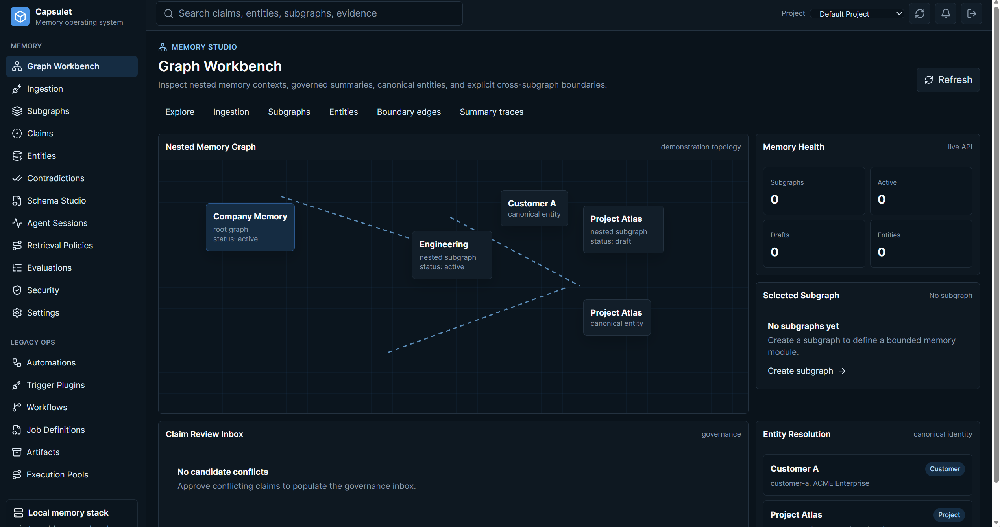

<!-- capsulet-claims: CAP-PRODUCT-001, CAP-CORRECTNESS-001, CAP-CORRECTNESS-002, CAP-GRAPH-001, CAP-AGENT-001, CAP-AGENT-002, CAP-AGENT-003, CAP-AGENT-004, CAP-AGENT-005, CAP-AGENT-006, CAP-AGENT-007, CAP-MEMORY-001, CAP-MEMORY-002, CAP-MEMORY-003, CAP-MEMORY-004, CAP-MEMORY-005, CAP-MEMORY-006, CAP-MEMORY-007, CAP-JOB-001, CAP-JOB-002, CAP-JOB-003, CAP-JOB-004, CAP-JOB-005, CAP-JOB-006, CAP-JOB-007, CAP-JOB-008, CAP-JOB-009, CAP-WORKFLOW-001, CAP-AUTOMATION-001, CAP-AUTOMATION-002, CAP-AUTOMATION-003, CAP-AUTOMATION-004, CAP-AUTOMATION-005, CAP-AUTOMATION-006, CAP-AUTOMATION-007, CAP-AUTOMATION-008, CAP-IAM-001, CAP-IAM-002, CAP-IAM-003, CAP-IAM-004, CAP-IAM-005, CAP-IAM-006, CAP-IAM-007, CAP-IAM-009, CAP-PERSISTENCE-001, CAP-DASHBOARD-001, CAP-SDK-001, CAP-OBSERVABILITY-001, CAP-SECURITY-001, CAP-HELM-001, CAP-CORRECTNESS-013, CAP-CORRECTNESS-015, CAP-CORRECTNESS-016, CAP-CORRECTNESS-018 -->
# Capsulet

Capsulet is a correctness-first AI-agent workflow platform for building and operating workflows
whose important outputs can be inspected, checked, and governed.

The product has three layers: an implemented workflow/job engine for deterministic execution and
compatibility, an experimental agent platform with typed graphs, a durable worker that executes them, and
governed memory, and a correctness plane whose deterministic kernel is implemented but whose runtime-wide admission and
assurance model is planned. See the
[product constitution](docs/superpowers/specs/2026-08-30-correctness-first-agent-workflow-platform-design.md)
and the [public claim registry](docs/contracts/product-claims.md) for the authoritative boundaries.
Public stability, migration, lifecycle, and SDK rules are indexed in
[docs/contracts](docs/contracts/README.md).

For a deterministic local check that needs no service containers, run
`cargo run -p capsulet-xtask --locked -- verify --profile fast`. The full release-equivalent graph
is `verify --profile full`; inspect its machine-readable definition with
`verify --list --format json`.



## What works today

- typed agent graph definitions with nodes, ports, hyperedges, transition policies, and static execution order
- agent definitions with graph references, step/token/time/cost budgets, and termination policies
- agent runs executed by a dedicated durable worker, with deterministic nodes, local-model nodes, memory reads, validators, and job and memory-write effects that happen once per run
- validators that send an agent round again until it passes or a budget stops it, with usage and every step readable from the run's log
- cancelling a run, and approving or refusing one waiting at a human gate, over the API
- claim-first memory records for sources, evidence, entities, claims, events, relationships, and contract DSL summaries
- nested memory subgraphs with owner, schema, permissions, summary-claim, summary-trace, membership, activation, canonical entity, graph attachment, and explicit cross-subgraph edge primitives
- deterministic local ingestion that proposes candidate claims and evidence-backed memory from uploaded text
- human review queues for candidate claims, entity-resolution proposals, and conflicting active claims
- reusable Python job definitions with JSON input schemas and retry policies
- compatibility workflow DAGs with parallel roots, fan-out, and fan-in dependencies
- manual, timezone-aware cron, read-only SQL, signed webhook, and isolated custom-plugin triggers
- bearer authentication with viewer/operator/admin authorization and durable mutation auditing
- durable PostgreSQL agent, graph, job, attempt, workflow-step, log, and artifact metadata
- stub, trusted local process, WASI Python, and Kubernetes Job runners
- S3-compatible or filesystem artifact storage, with SeaweedFS bundled as the S3 store in Compose and the chart
- enforced execution-pool concurrency, cancellation, timeouts, delayed retry, and stale-lease recovery
- owner-bound worker heartbeats and finalization that fence stale workers after lease adoption
- workflow resume from successful step checkpoints after failure or timeout
- Kubernetes Job reattachment after worker failure
- API, worker, scheduler, and evaluator health and Prometheus metrics endpoints
- configurable artifact, log, trigger-event, and audit retention cleanup
- a Docker Compose stack whose secrets and seeded identities are generated for each stack, and a hardened Helm chart
- one release identity, `release.toml`, that every crate, the Python SDK, the dashboard, the chart and every image is checked against
- container images built once per release, scanned, and published by digest with SLSA build provenance, an SBOM attestation and a keyless Sigstore signature

## Product layers

Capsulet is organized as three cooperating layers:

- **Workflow engine (implemented compatibility infrastructure):** durable jobs, runners, workflow
  DAGs, triggers, retries, cancellation, logs, and artifacts.
- **Agent platform (experimental):** typed agent definitions and static execution graphs, budgets,
  validators that drive a bounded loop, and a durable worker that executes them against governed
  memory and a local model. A graph where a model chooses the next node cannot run yet and is refused
  at run start, and a finished run is `unverified`: nothing has checked its result.
- **Correctness plane (implemented kernel slice; planned platform enforcement):** proposals,
  deterministic checks, evidence, residual obligations, and certificates. Runtime-wide protected
  boundary admission and the unified verified-computation IR are not implemented yet.

Governed memory is a major agent-platform subsystem, not Capsulet's complete identity. It models
claims, entities, events, relationships, evidence, permissions, source authority, contradictions,
review state, and nested contexts.

An agent definition binds a graph to a control envelope: iterations, tokens, runtime seconds, cost, and explicit termination conditions. Starting a run compiles the agent into a versioned definition, and the graph worker executes it as a bounded loop. Node configuration is part of that version, so changing a prompt makes a new one. A failed validator sends the run round again with what its last attempt left. A budget, a lack of progress, a safety check or a person's refusal ends it as `stopped`, never as `succeeded`.

```text
state -> agent-enter -> (your graph) -> agent-continue -> agent-leave -> state
                             |                 |
                             v                 v
                   event log and usage    go round again?
```

The memory graph is claim-first. A claim records what was said, who or what it is about, where it came from, when it was observed or valid, its confidence, and its review state. Nested subgraphs provide bounded memory contexts for teams, projects, customers, incidents, or personal modules. Each active subgraph must have an owner, schema, permissions, summary claim, and traceability from that summary back to inner claims or evidence. Canonical entities connect local entities across subgraphs without erasing context-specific disagreement.

```text
raw text -> source/evidence -> candidate claims -> review -> active memory
                                           |             |
                                           v             v
                                  entity resolution   conflict inbox
```

## Correctness direction and current boundary

The deterministic three-valued kernel and a narrow reasoning/certificate API slice are implemented.
The four-valued platform assurance model, trust-typed workflow IR, universal admission checks, and
durable looping graph worker are planned. The full direction is in the
[product constitution](docs/superpowers/specs/2026-08-30-correctness-first-agent-workflow-platform-design.md);
the narrower proposer/checker foundation remains in
[docs/design/correctness-architecture.md](docs/design/correctness-architecture.md) and
[ADR 0012](docs/adr/0012-correctness-kernel-and-proposer-checker-split.md).

The goal is not to replace frontier models. It is to make a small model good enough for complex
work, by making correctness a property of the system rather than of the model. Small models are
poor at long chains and roughly adequate at single hops, so the plan is to only ever ask for a
single hop and move composition into deterministic mechanisms that can check it explicitly.

That requires being precise about what can be checked. Whether an id exists, whether a claim is
active, whether a quoted string is byte-identical to the span it cites, whether arithmetic
recomputes, whether two intervals overlap, whether a predicate is declared with that arity —
all of these are mechanically decidable with no model in the loop. Whether a passage *means* what
a claim says it means is not, and no amount of architecture changes that.

So the boundary becomes the product. A node returns a proposal rather than a value; a
deterministic kernel with no learned component decides it and emits a certificate; and the
verdict is three-valued. **Accepted** means every step was discharged mechanically. **Conditional**
means the result is sound given a set of named readings, each pinned to a span. **Rejected** names
the failed premise and the subsystem that owns the repair. For contract-declared number, money,
and date objects, citations compare exact values rather than their spelling. An unresolved shared
currency symbol or numeric day/month date is an evidence-linked residual, never a guessed value
(`CAP-CORRECTNESS-013`). An answer is held to the question it was asked: pinned to a typed query,
a grounded fact that answers a different question is rejected, and a question asked only in words
leaves the proposer's reading of it as a residual for review (`CAP-CORRECTNESS-015`). And an exact
quote is read with what could change its meaning: under a contract that declares its structure, a
clause "subject to" another provision, overridden by one, or using a defined term is not a statement
on its own, and each qualifying provision or definition the answer left out is named for review
(`CAP-CORRECTNESS-016`). On a labelled corpus of answers about one agreement written for the purpose, no
misread or non-responsive answer reaches `accepted` except the one case it names as a limitation
(`CAP-CORRECTNESS-018`); that is a fixture, not a measurement on real contracts. Capsulet does
not verify meaning today either — the difference is that it would stop implying otherwise, and
report per answer exactly what was mechanically discharged and what was assumed.

Learned components stay on the proposer side of that line. Knowledge graph embeddings are
well suited to generating retrieval candidates and ordering search, and unsuited to deciding
truth; an embedding score never appears in a certificate.

```text
proposer -> kernel (deterministic) -> certificate
            no model, no network       verdict + discharged steps
            no I/O beyond the store    + residual obligations
```

## How execution stays durable

PostgreSQL is the source of truth. An agent run's status is a fold over its append-only event log, so a worker that dies mid-run loses nothing: the next one reads the log and carries on. Effects are claimed before they are attempted, so a job or a memory write happens once however many workers it takes. See [ADR 0019](docs/adr/0019-agent-runs-execute-on-the-durable-path.md).

The existing job runner path remains durable as the lower-level execution substrate. A worker atomically leases a queued job, records the attempt, and renews the lease while execution is active. After lease expiry, non-reattachable work is requeued; Kubernetes work can be adopted by another worker without incrementing the attempt count. Heartbeat and finalization both require the current lease owner, so the previous worker cannot commit a result after adoption. See [ADR 0013](docs/adr/0013-owner-bound-finalization-for-adoptable-job-attempts.md).

Compatibility workflow nodes still have durable step runs. Successful nodes are checkpoints: their metadata and artifacts remain complete even when another branch fails. Calling the resume endpoint removes only unsuccessful attempts and lets the scheduler reconstruct the missing runnable nodes from the saved graph state.

## Local Docker Compose

Prerequisites: Docker with Compose v2.

```sh
cargo run -p capsulet-xtask -- stack up
```

This generates the stack's secrets, builds and starts it, waits for every health check and seeds
two projects with an identity per role ([test identities](docs/development/test-identities.md)).
Open the dashboard at <http://127.0.0.1:3000> and the API at <http://127.0.0.1:8080>.
`cargo run -p capsulet-xtask -- stack down` removes it, volumes and secrets included.

The local stack includes PostgreSQL, SeaweedFS as the S3 object store, Keycloak, Mailpit, API, worker, graph worker, scheduler, evaluator, dashboard, Prometheus and Grafana. Artifacts and logs go through the same S3 adapter a deployment uses. Compose waits on dependency health and restarts long-running services after failure. Sign in with the admin login in `.capsulet/stack/capsulet-local/fixture.json`; no local credential is checked in.

`stack up` uses the ports above. To move one, set its variable first, for example
`CAPSULET_POSTGRES_HOST_PORT` when Windows reserves 55432; `compose.yaml` lists each one.

Compose itself needs the stack's project name and environment file, because nothing in
`compose.yaml` is a default credential:

```powershell
$env:COMPOSE_PROJECT_NAME = "capsulet-local"
$env:COMPOSE_ENV_FILES = ".capsulet/stack/capsulet-local/stack.env"
curl http://127.0.0.1:8080/readyz
docker compose logs -f api worker graph-worker scheduler evaluator
docker compose stop    # keeps the volumes; `stack up` starts it again
```

## Agent execution graph API

Create typed graphs, bind them to agents, and start agent runs:

```sh
curl -H 'Authorization: Bearer <token>' -X POST http://127.0.0.1:8080/v1/graphs
curl -H 'Authorization: Bearer <token>' -X POST http://127.0.0.1:8080/v1/agents
curl -H 'Authorization: Bearer <token>' -X POST http://127.0.0.1:8080/v1/agents/<agent-id>/runs
```

Read a run, read its log, and act on it:

```sh
curl -H 'Authorization: Bearer <token>' http://127.0.0.1:8080/v1/agent-runs/<run-id>
curl -H 'Authorization: Bearer <token>' http://127.0.0.1:8080/v1/agent-runs/<run-id>/events
curl -H 'Authorization: Bearer <token>' -X POST http://127.0.0.1:8080/v1/agent-runs/<run-id>/cancel
curl -H 'Authorization: Bearer <token>' -H 'Content-Type: application/json' \
  -d '{"approved":true}' -X POST http://127.0.0.1:8080/v1/agent-runs/<run-id>/decisions
```

Model nodes use a local [Ollama](https://ollama.com) at `CAPSULET_OLLAMA_URL`. With none reachable they
fail and say so, and everything deterministic still runs. See [the API guide](docs/api.md#agents-and-agent-runs)
for what a node can be configured to do. `scripts/agent-smoke.ps1` runs agents through the stack, killing
the worker mid-run.

## Memory Studio API

Memory APIs are tenant/project scoped and claim-first. They support direct authoring, deterministic ingestion, review, and nested graph governance:

```sh
curl -H 'Authorization: Bearer <token>' http://127.0.0.1:8080/v1/memory/sources
curl -H 'Authorization: Bearer <token>' http://127.0.0.1:8080/v1/memory/claims
curl -H 'Authorization: Bearer <token>' http://127.0.0.1:8080/v1/ingestion/review/claims?status=candidate
curl -H 'Authorization: Bearer <token>' http://127.0.0.1:8080/v1/memory/entity-resolutions?status=candidate
curl -H 'Authorization: Bearer <token>' http://127.0.0.1:8080/v1/memory/conflicts?status=candidate
```

The dashboard Memory Studio exposes ingestion, claim review, entity resolution, nested graph activation, and the conflict inbox as the first product surface for governing memory before agents consume it.

## Kernel certificate API

The first slice of the correctness architecture is implemented: stored text is
cut into byte-exact citable spans, retrieval pins the legal evidence set, a local
model proposes a derivation, and a deterministic kernel decides it. The response
is a certificate, not a bare answer.

Requires a local [Ollama](https://ollama.com) with a small model pulled. The
proposer runs outside the stack on purpose — correctness does not depend on it:

```sh
ollama pull qwen2.5:1.5b
# Ollama must accept traffic from the containers
OLLAMA_HOST=0.0.0.0 ollama serve
```

```sh
curl -X POST -H 'Authorization: Bearer <token>' -H 'Content-Type: application/json' \
  -d '{"text":"Acme renewed the Contoso contract on 2026-03-01. Notice is 30 days.",
       "question":"When was the contract renewed?",
       "contract_id":"<a memory contract whose relations declare stated_by phrasings>"}' \
  http://127.0.0.1:8080/v1/reasoning/ask

curl -H 'Authorization: Bearer <token>' http://127.0.0.1:8080/v1/reasoning/certificates
```

Verdicts are three-valued. **accepted** means every step was discharged
mechanically: the cited span re-derived byte-for-byte from the stored source and
states the claim in a phrasing its memory contract declares for the relation, in
one sentence that does not deny, hedge or question it. **conditional** means the
derivation required a reading, which is recorded as a residual obligation pinned
to the span it came from — which is every answer when no `contract_id` is given,
because then no relation has a declared phrasing to be stated in. **rejected** names the failed premise and the subsystem that
owns the repair, so a dangling reference re-runs retrieval instead of re-prompting
the model.

Persisted kernel proposals always identify their schema. Offline replay reads a
versionless legacy proposal as v1, refuses unsupported proposal versions as unreadable,
and keeps malformed v1 input distinct; it does not claim a verdict for unreadable input.

Two limits are deliberate and documented: a declared phrasing is matched, not
entailed — a sentence can still doubt it in words no cue list knows — and
relevance to the question is not checked at all. See
[the design note](docs/design/correctness-architecture.md).

## Compatibility workflow recovery API

Resume a failed or timed-out workflow run:

```sh
curl -H 'Authorization: Bearer <token>' -X POST http://127.0.0.1:8080/v1/workflow-runs/<run-id>/resume
```

The response contains the workflow run and preserved successful step runs. Active, queued, cancelled, removed, and successful runs are rejected to avoid ambiguous recovery.

## Kubernetes with Helm

The chart installs the API, worker, graph worker, scheduler, evaluator, dashboard, migration job, separated control-plane/execution service accounts, default-deny execution network policy, services, configuration, and optional bundled PostgreSQL and SeaweedFS.

```sh
helm lint charts/capsulet
kubectl create namespace capsulet
# A fresh administrator token: keep it, it is how you sign in to the API.
token="$(openssl rand -hex 32)"
kubectl create secret generic capsulet-api-auth \
  --namespace capsulet \
  --from-literal="tokens=[{\"name\":\"cluster-admin\",\"role\":\"admin\",\"token\":\"$token\"}]"
helm install capsulet charts/capsulet \
  --namespace capsulet \
  --set api.auth.existingSecret=capsulet-api-auth

kubectl wait --for=condition=available deployment \
  --all --namespace capsulet --timeout=5m
kubectl port-forward service/capsulet-dashboard 3000:80 --namespace capsulet
```

The chart runs one image per component, such as `ghcr.io/mohripan/capsulet-api` at the chart's
version: the images a `v<version>` tag publishes. Each build of `main` is published as `main` and `sha-<commit>`, so until a version is
tagged, install with `--set image.tag=main`, or better, pin each component's
`<component>.image.digest` from that run's release manifest. Every published image is signed and
carries SLSA provenance and an SBOM; the [supply chain](docs/security/supply-chain.md) shows how to
verify one before you run it.

Production deployments should use external managed PostgreSQL and object storage, images pinned by digest, network policies, and dedicated execution capacity. Capsulet constrains execution pods but does not claim to be a complete sandbox for hostile code.

See [installation](docs/installation.md), [Helm values](docs/helm-values.md), and [worker/runner design](docs/worker-runner.md) for configuration details.

## Repository layout

```text
crates/
  api/           HTTP control plane and its generated OpenAPI contract
  application/   application services, agent runtime use cases, and ports
  core/          domain types, state machines, and validation rules
  ir/            the verified-computation IR: canonical encoding, digests, schema versions
  ir-adapters/   translation of workflows, agent graphs and governed memory into the IR
  kernel/        the deterministic correctness kernel that decides and certifies
  proposer/      untrusted proposers, including a local Ollama adapter
  replay/        offline certificate replay and tamper detection
  runtime/       IR execution runtime
  postgres/      SQLx persistence and migrations
  runner/        runner contracts plus stub, process, WASI, and Kubernetes adapters
  scheduler/     compatibility automation triggering and DAG reconciliation
  evaluator/     durable trigger evaluation and retention cleanup
  worker/        job runtime loop, runner selection, and health endpoints
  graph-worker/  durable worker that executes agent runs and IR runs
  storage/       filesystem and S3-compatible object storage
  observability/ tracing and metrics
  cli/           command-line client
  xtask/         the verifier, the stack fixture, and the release and supply-chain checks
dashboard/       Next.js dashboard
sdk/python/      decorator-based Python workflow SDK
charts/capsulet/ Helm chart
migrations/      PostgreSQL schema history
release.toml     the release identity
```

## Development and verification

Every check is a gate of the verifier, defined once in `crates/xtask` and run the same way on a
laptop and in CI:

```powershell
cargo run -p capsulet-xtask --locked -- verify --profile fast   # no service containers
cargo run -p capsulet-xtask --locked -- verify --profile full   # every gate CI requires
cargo run -p capsulet-xtask --locked -- verify --gate <name>    # one gate
cargo run -p capsulet-xtask --locked -- verify --list           # what each gate runs
cargo run -p capsulet-xtask --locked -- verify doctor           # tool versions against the minimums
```

The gates cover:

- formatting, Clippy and the workspace's tests;
- PostgreSQL, migrations and crash recovery against disposable databases;
- the claim registry and the generated OpenAPI and authorization contracts;
- the Python SDK and the dashboard;
- dependency, license and secret policy;
- Compose and Playwright on stacks of their own;
- the chart, rendered and checked, then installed and exercised on a Kind cluster of its own;
- the release identity, the container images and the supply-chain workflows.

In CI each job runs some of these gates, and the `Required` job passes only when every gate of the
full profile ran and passed; see [CI](docs/development/ci.md). The
[verification matrix](docs/contracts/verification-matrix.md) lists them all. Before changing a
public claim, endpoint, status or client call, read the [public contracts](docs/contracts/README.md)
and the [development guide](docs/development.md).

Rust is pinned to 1.99.0; the dashboard needs Node.js 20 or newer, and `claims-evidence` needs 24.
A version change goes through `release set`; see the
[release process](docs/contracts/release-process.md).

### Python workflow authoring

Python workflows are still available as a compatibility authoring path and as a useful substrate for deterministic agent tools. They can be authored as decorated Python functions or as Python cells in the dashboard notebook. The [CSV artifact pipeline](examples/workflows/csv_pipeline.py) creates a CSV in one task, passes it to a dependent task, and downloads the transformed artifact. See the [example instructions](examples/workflows/README.md) for the end-to-end commands.

The `postgres`, `migrations` and `chaos` gates start disposable PostgreSQL containers and give
each database test a database of its own; to run those tests by hand against a server of yours, set
`CAPSULET_TEST_DATABASE_URL`.

## Documentation

- [Architecture](ARCHITECTURE.md)
- [Correctness architecture (direction)](docs/design/correctness-architecture.md)
- [API](docs/api.md)
- [Development](docs/development.md) and [test identities](docs/development/test-identities.md)
- [Installation](docs/installation.md) and [Helm values](docs/helm-values.md)
- [Persistence](docs/persistence.md)
- [Security](docs/security.md) and the [supply chain](docs/security/supply-chain.md)
- [Release process](docs/contracts/release-process.md)
- [Verification matrix](docs/contracts/verification-matrix.md), [CI](docs/development/ci.md), and
  the [M1 completion report](docs/contracts/m1-completion.md)

## License

Apache-2.0. See [LICENSE](LICENSE).
